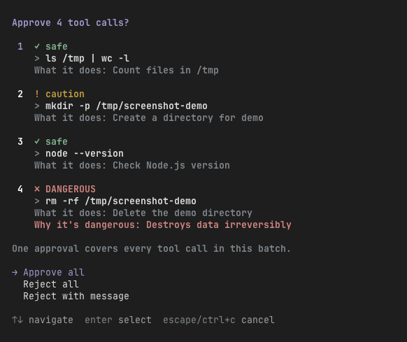

# pi-seatbelt

A safe, ergonomic permission system for pi. Your agent, your
rules: safety without slowing you down.

The headline feature: one approval for a whole chain of tool calls. A cheap
classifier model labels every call `safe`, `caution`, or `DANGEROUS`, says
what it does, and when something is dangerous, says why. You see the full
chain, you approve once, the agent runs. No more approving commands one at
a time.



Three choices: `Approve all`, `Reject all`, or `Reject with message`. The
message goes straight back to the agent as the rejection reason, so it knows
why and can adjust instead of blindly retrying.

You decide which tools are gated (default: `bash`), which mode you run in,
and what the labeller calls dangerous. Your rules, your machine.

## Install

```sh
pi install git:github.com/mikesposito/pi-seatbelt
```

Try it once without installing:

```sh
pi -e git:github.com/mikesposito/pi-seatbelt
```

Local development: symlink the checkout into your extensions directory, or
load it per run.

```sh
ln -s /path/to/pi-seatbelt ~/.pi/agent/extensions/seatbelt
pi -e /path/to/pi-seatbelt
```

No runtime dependencies. The package manifest declares the host-provided pi
packages as peers.

## Three modes, one key

Press the mode key to cycle: `alt+b` by default, or any key you set (see
`shortcut` under [Configure](#configure)). The status bar always shows
where you are: `perm:all`, `perm:auto`, `perm:off`. The choice persists.

- `all`: every chain asks once. The default.
- `auto`: no dialog unless something is `DANGEROUS`. Labels decide what runs
  silently, so pair it with a good policy file.
- `off`: no gating, no classifier calls, no cost.

Headless modes (print, JSON) have no dialogs: only `safe` calls auto-run,
everything else is blocked with a reason.

Calls made through nested execution (codemode scripts) never appear in an
assistant message, so they are approved one at a time as a fallback.

## Your policy decides what is dangerous

The labels come from the classifier model. You steer the model with a plain
markdown file: `~/.pi/agent/seatbelt/policy.md`.

- Write plain sentences. No syntax to learn.
- Everything you write is appended to the labeller's instructions as *your*
  policy, overriding the built-in defaults.
- Re-read before every batch. Edits apply immediately, no reload.
- Ships as a header-only template that is ignored until you add rules.

Example:

```markdown
# My policy

- Treat every docker command as dangerous: my machine has stateful containers.
- Treat `npm test`, `yarn build`, and `git status` in ~/dev/my-project as safe.
- Treat `git push` to origin main as dangerous; feature branches are caution.
- Treat any command that writes outside /tmp as dangerous.
```

One limit: policy shapes the model's labels. With no model configured, a
built-in regex fallback labels calls and the policy file is not consulted.

## Configure

`~/.pi/agent/seatbelt/config.json` (not in this repo):

```json
{
  "model": "litellm/DeepSeek-V4-Flash",
  "timeoutMs": 20000,
  "mode": "all",
  "shortcut": "alt+b",
  "tools": ["bash", "write", "edit", "mcp__slack__*"]
}
```

- `tools`: what gets gated. Exact names (`read`, `write`, `edit`,
  `mcp__github__create_issue`) or prefix patterns (`mcp__slack__*` for a
  whole server, `*` for everything). Non-bash calls are shown to the
  labeller as tool name plus arguments, truncated to 500 characters.
- `shortcut`: the key that cycles the permission modes, as a pi key id
  (`"alt+b"`, `"ctrl+shift+p"`, `"f9"`). Read at startup, so a change
  needs a new session. Anything malformed falls back to `alt+b`.
- `model`: the labeller. Pick one with `/seatbelt`, or pass it directly:
  `/seatbelt litellm/gpt-4o-mini`. Fast and cheap works well; the prompt
  is tiny. Without a model, or if the call fails or times out, the regex
  fallback takes over.
- `timeoutMs`: give up on the labeller after this long and fall back.

Both config files are seeded as templates on first load. Fresh installs get a
one-time notice to run `/seatbelt`.

## Test

```sh
node smoke.mjs
```
